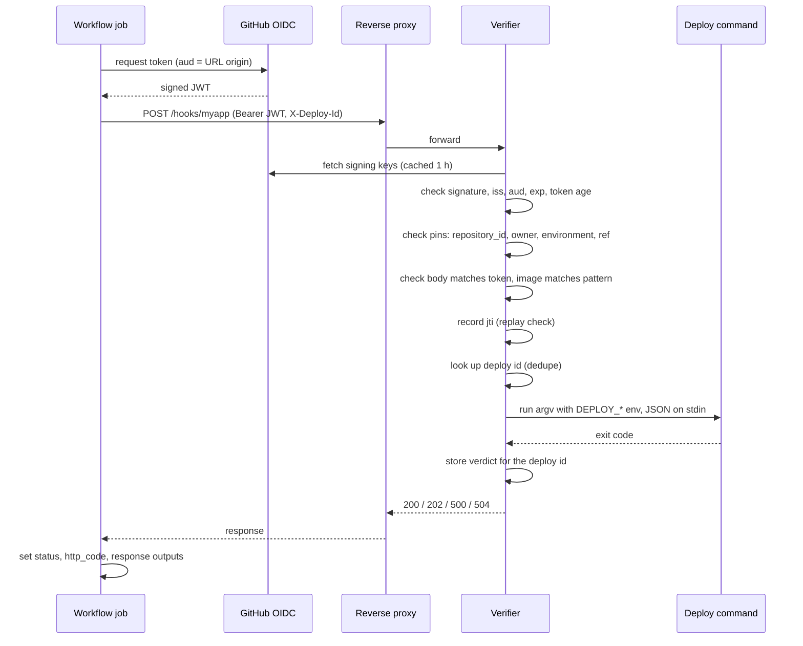

# How it works

One deploy, with OIDC and the reference verifier:

With HMAC, the job signs the body with the shared secret instead of asking GitHub for a
token. The verifier then checks the timestamp and signature, and takes the repository, SHA,
ref and actor from the body instead of the token.

## Authentication

The action asks GitHub for an OIDC token whose `aud` is the origin of `url`, unless you set
`audience`. The verifier checks the token's signature against GitHub's published keys,
then the issuer, audience and expiry. It rejects tokens issued more than `max_token_age`
seconds ago.

Next, it compares the token's claims with the app's pins. `repository_id` must match.
`repository_owner_id`, `environment` and `ref` must match when set, and the verifier refuses
to start unless an app pins `environment` or `ref`. A job can only get a token for an
environment it runs in, so environment protection rules (reviewers, branch rules) also
guard the deploy.

Finally, the body's `repository_id`, `sha`, `run_id` and `run_attempt` must match the
token, and the deploy id must start with the token's run id and attempt. A valid token from
one run can't be paired with a body from another.

## Replay

Each credential works once. The verifier stores each OIDC token's `jti` until the token
expires, and each HMAC signature until its 5-minute window closes. A second request with
the same credential gets `401 replayed credentials`.

## Retries and dedupe

The two checks above work together. A retry from the action carries a new credential, so it
passes the replay check. It keeps the same deploy id, so dedupe catches it:

- If the first attempt already finished as deployed or deferred, the verifier returns the
  stored verdict with `"duplicate": true` and runs nothing.
- If it's still running, the verifier answers `409`.
- If it failed, the verifier runs the command again.

Re-running the workflow from GitHub creates a new run attempt, so the deploy id changes and
the deploy runs again. The verifier keeps deploy records for 7 days.

## Timeouts

There are two timeouts:

- The action's `timeout` input, for the whole HTTP request.
- The app's `timeout` in `config.toml`, for the deploy command.

Keep the app's `timeout` at or below the action's. Then the verifier kills a stuck command
and answers `504` before the action gives up.

If the action times out first, the step fails with "no response within Ns; the server may
still be deploying". The action doesn't retry a timeout or a `504`, because the deploy may
still be running and a retry could start a second one. Check the server log for the real
outcome.

If the verifier restarts during a deploy, it marks that deploy as failed on startup. A
retry with the same deploy id then runs the command again.

## Design notes

[DESIGN.md](https://github.com/HEROgold/deploy-notifier/blob/main/DESIGN.md) records why
each of these choices was made.
